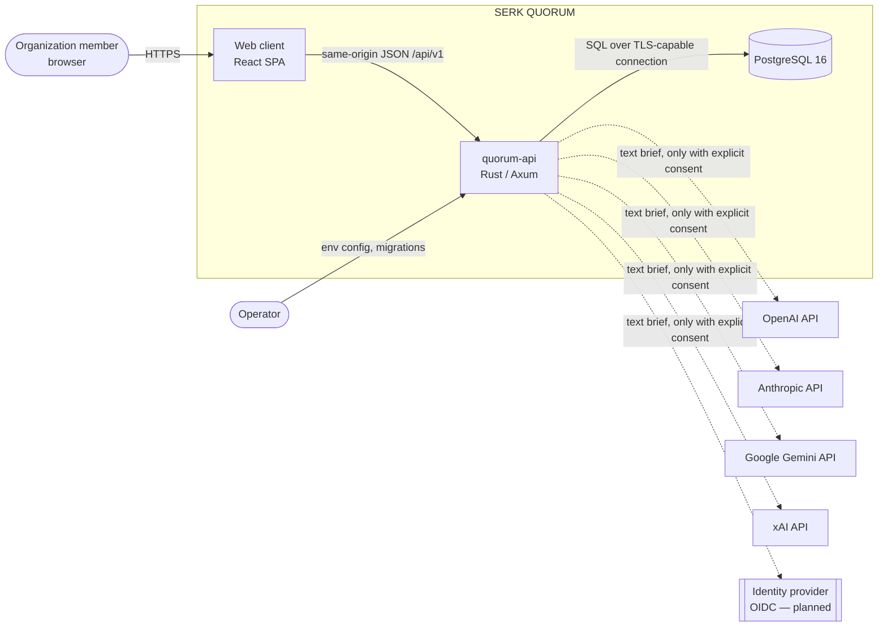
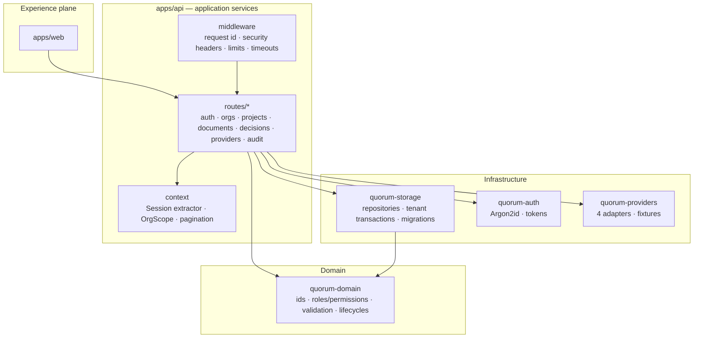
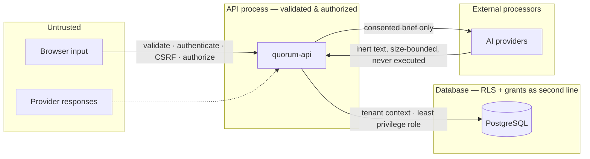
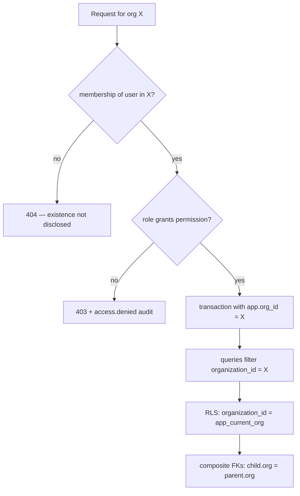
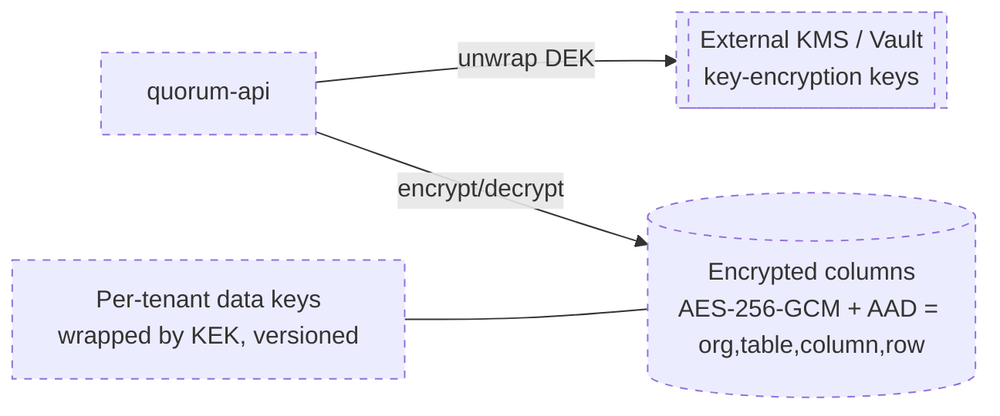
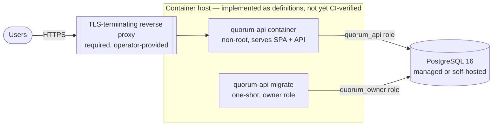

# Architecture

This document describes what is **implemented in v0.2**. Future architecture is labelled *Planned* and drawn with dashed lines. Diagrams use Mermaid and render on GitHub.

## 1. System context



## 2. Logical architecture (modular monolith)

One deployable binary with internal boundaries. Crates depend inward on the domain; the domain depends on nothing with I/O.



| Plane (directive §04) | v0.2 realisation |
| --- | --- |
| Experience | `apps/web` |
| Identity & access | `quorum-auth`, `context::Session`, `context::OrgScope`, `quorum-domain::access` |
| Application services | `apps/api/src/routes` |
| Provider integration | `quorum-providers` |
| Knowledge & documents | documents + versions (storage, routes); Memory/Vault *planned* |
| Data protection | RLS, grants, hashing; field encryption *planned* (§7) |
| Governance & audit | audit events, roles; policies *planned* |
| Commercial | usage ledger (`provider_requests`); entitlements/billing *planned* |
| Observability & operations | `tracing` structured logs, correlation IDs, health endpoints; metrics/OTel *planned* |

Application services currently live in the API crate rather than a separate `quorum-application` crate; extraction is deferred until a second delivery mechanism (worker, CLI) needs them (ADR 0001).

## 3. Request lifecycle and trust boundaries

```mermaid
sequenceDiagram
  autonumber
  participant B as Browser
  participant M as Middleware
  participant H as Handler
  participant S as Session extractor
  participant O as OrgScope
  participant P as PostgreSQL
  B->>M: POST /api/v1/orgs/{org}/projects (cookie, x-csrf-token, JSON)
  M->>M: assign x-request-id · 1 MiB body limit · timeout
  M->>H: route
  H->>S: extract session
  S->>P: auth_find_session(sha256(token)) [SECURITY DEFINER]
  S->>S: constant-time CSRF check (non-GET)
  H->>O: open(org, Permission::ProjectsManage)
  O->>P: BEGIN; set_config(app.user_id, app.org_id, local)
  O->>P: role_of(org, user)  — none → 404, insufficient → 403 (+ audit)
  H->>P: INSERT … (RLS WITH CHECK org = app.org_id)
  H->>P: INSERT audit_events
  H->>P: COMMIT (context discarded)
  H-->>B: 201 JSON + security headers + x-request-id
```

Trust boundaries:



## 4. Identity architecture

* **Implemented:** local accounts (email + Argon2id), server-side sessions in `sessions` (SHA-256 digest of a 256-bit token, CSRF token, expiry, revocation). Login/session/invitation lookups happen through narrowly scoped `SECURITY DEFINER` SQL functions because no tenant context exists yet at that point.
* **Planned:** OpenID Connect (authorization code + PKCE) as an additional way to *establish* the same session; MFA delegated to the IdP; SCIM or just-in-time provisioning; account recovery. See ADR 0003.

## 5. Organization isolation



Three independent layers must all fail for a cross-tenant read or write. Integration tests exercise each layer separately, including with RLS deliberately disabled (mutation check recorded in the testing guide).

## 6. Provider integration

`quorum-providers` builds one HTTP request per call (OpenAI and xAI Responses API, Anthropic Messages API, Gemini `generateContent`), with a fixed guard system prompt, the user brief framed as untrusted material, `store: false` where supported, a bounded output token count, timeout and a 2 MiB response cap. There is no tool calling, function calling, streaming to tools, or chaining between models. Fixture mode returns labelled static text and is never substituted for a failed live call.

## 7. Key management (*Planned*)

No field-level encryption exists in v0.2. Provider keys are environment variables of the API process; passwords and tokens are hashed, not encrypted.



See [PRIVACY_ARCHITECTURE.md](PRIVACY_ARCHITECTURE.md) for what is and is not encrypted today.

## 8. Document lifecycle

```mermaid
stateDiagram-v2
  [*] --> Draft: create (version 1)
  Draft --> Draft: save → new immutable version (base_version must match)
  Draft --> Approved: approve current version (documents_approve)
  Approved --> Draft: save → new version (approved version stays in history)
  note right of Approved: Export to Markdown at any version; AI-assisted versions are labelled
```

Decision lifecycle: see `crates/quorum-domain/src/decision.rs` (state diagram in the module docs) and [DATA_MODEL.md](DATA_MODEL.md).

## 9. Deployment



Profiles (development / private pilot / production) are described in [DEPLOYMENT_GUIDE.md](DEPLOYMENT_GUIDE.md).

## 10. Technology choices

Rust 1.97 (MSRV 1.88), Axum 0.8, Tokio 1, sqlx 0.9 (runtime queries, Postgres, rustls), tower-http 0.7, reqwest 0.13 (rustls), argon2 0.6, tracing. Web: React 19, React Router 7, TypeScript 5.9 strict, Vite 8, Vitest 5, Playwright 1.63, axe-core 4.14. Versions are pinned in `Cargo.lock` and `package-lock.json`. Redis, object storage, pgvector and OpenTelemetry are not used yet; each will be introduced only with a measured need.
