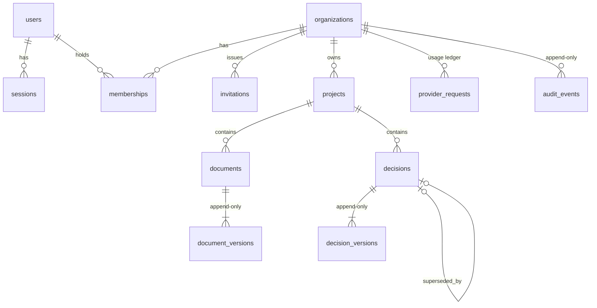

# Data model

Source of truth: [`migrations/0001_foundation.sql`](../migrations/0001_foundation.sql). This document explains it.

## Tables

| Table | Tenant-scoped | Purpose | App role grants |
| --- | --- | --- | --- |
| `users` | no (RLS: self + members of current org) | identities; `password_hash` NULL for future IdP-only accounts | S I U |
| `sessions` | per user (RLS: own) | SHA-256 token digest, CSRF token, expiry, revocation | S I U |
| `organizations` | yes | tenant root | S I U |
| `memberships` | yes (also readable by the member) | user ↔ org with one of 8 roles | S I U D |
| `invitations` | yes | email-bound, single-use, expiring, token digest only | S I U D |
| `projects` | yes | name unique per org (case-insensitive), status | S I U D |
| `documents` | yes | current/approved version pointers | S I U D |
| `document_versions` | yes | immutable versions (title, body, AI-assisted flag, note) | **S I** |
| `decisions` | yes | decision record, status, `superseded_by`, version | S I U D |
| `decision_versions` | yes | JSON snapshot per change with note | **S I** |
| `provider_requests` | yes | usage metadata: provider, model, mode, outcome, prompt length, tokens, latency — **no prompt or response text** | **S I** |
| `audit_events` | yes (NULL org for pre-auth events) | actor, type, resource, outcome, correlation ID, small details | **S I** |

S/I/U/D = SELECT/INSERT/UPDATE/DELETE for role `quorum_app`.

## Integrity rules enforced by the database

* Composite foreign keys `(project_id, organization_id)`, `(document_id, organization_id)`, `(decision_id, organization_id)` and `(superseded_by, organization_id)` make cross-tenant parent/child links impossible.
* `decisions_protect_content` trigger: content of decisions in `under_review`, `approved`, `rejected` or `superseded` cannot change; `superseded` is final. Applies to every role, including the owner.
* Checks: role and status enumerations, `superseded ⇔ superseded_by IS NOT NULL`, no self-supersession, `approved_version ≤ current_version`, non-negative counters, digest length 32, audit event type format.
* Uniqueness: `users.email_normalized`, `sessions.token_digest`, `invitations.token_digest`, `(organization_id, lower(projects.name))`, `(project_id, decisions.number)`, `(document_id, version)`, `(decision_id, version)`.

## Concurrency

* Document saves and decision edits use optimistic concurrency (`base_version`) plus `SELECT … FOR UPDATE` on the row.
* Decision numbers (`DEC-0001`…) are allocated under the project row lock.
* Children always lock the project row first, then the child row (consistent lock order).

## Identifiers and time

UUIDv7 (time-ordered) for all primary keys, generated in Rust (`quorum-domain::ids`). All timestamps are `timestamptz`, serialized as RFC 3339 UTC. Review dates are `date` (`YYYY-MM-DD`).

## Migrations

sqlx records each migration with a checksum in `_sqlx_migrations`; editing an applied migration fails the next run. Tests apply migrations to a fresh database for every test and re-run them to check idempotence. Upgrade testing across versions starts with the next migration (only one exists).

## Planned tables (not created)

`milestones`, `tasks`, `attachments`, `knowledge_records`, `provider_configurations`, `review_records`, `subscriptions`, `entitlements`, `invoices`, `retention_policies`, `organization_policies`. They will be added when their features are built, each with RLS, grants and isolation tests.
